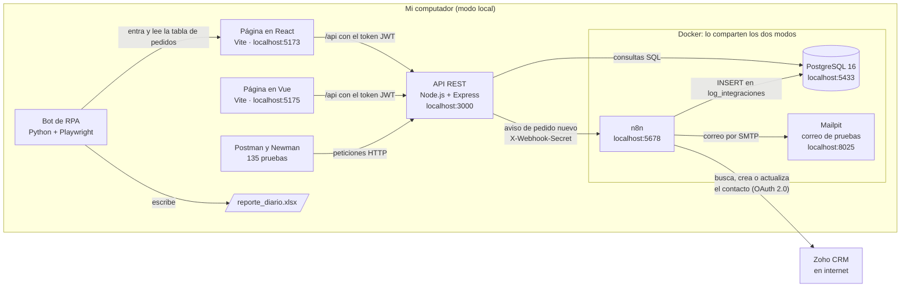

# Cielum · Inducción backend · Nicolas Rendón

Repositorio de mi inducción en Cielum: la bitácora de cada día, los ejercicios de cada tema y el proyecto integrador.

## El proyecto integrador

Una tienda con clientes, productos y pedidos. Un vendedor entra a la página, crea un pedido y lo demás pasa solo: la API lo guarda en PostgreSQL, n8n pasa el cliente a Zoho CRM, lo registra en la base y manda un correo. Un bot de Python arma el reporte diario en Excel leyendo la página.



Qué hace cada parte, el camino de un pedido, la base de datos, la seguridad y el manejo de errores están en [`docs/arquitectura.md`](docs/arquitectura.md).

## Cómo prenderlo

Los pasos completos, también los de la primera vez, están en [`proyecto/README.md`](proyecto/README.md).

La base, n8n y Mailpit corren siempre en Docker y los comparten los dos modos, así que todo queda guardado en un solo lugar. Primero, parado en `proyecto`, con el `.env` lleno:

```powershell
docker compose up -d postgres mailpit n8n
```

**Opción 1: modo local (la principal).** La API y la página corren en el computador, cada una en su terminal:

| Parte | Parado en | Comando | Queda en |
|---|---|---|---|
| API | `proyecto/api` | `npm run dev` | <http://localhost:3000> |
| Página en React | `proyecto/frontend-react` | `npm run dev` | <http://localhost:5173> |

**Opción 2: todo en Docker.** Parado en `proyecto`:

```powershell
docker compose up -d --build
```

Prende también la API y las páginas en contenedores: la página en React queda en <http://localhost:8080>, la de Vue en <http://localhost:8082> y la API en <http://localhost:3001>.

En los dos modos, n8n está en <http://localhost:5678>, Mailpit en <http://localhost:8025> y la base en `localhost:5433`.

El usuario de prueba es `vendedor@cielum.test` con la contraseña `Vendedor2026*`.

## Qué hay en el repositorio

| Carpeta o archivo | Qué tiene |
|---|---|
| `bitacora/` | La bitácora de cada día: preguntas investigadas, lo que aprendí, los errores y cómo los resolví |
| `semana-1/` | Ejercicios y retos de JavaScript, Python y SQL básico |
| `semana-2/` | Ejercicios de SQL avanzado, Node.js y Express, Postman y Docker |
| `semana-3/` | Ejercicios de React, Vue, Zoho CRM, y RPA con n8n |
| `proyecto/` | El proyecto integrador: API, base de datos, Postman, Docker, React, Vue, Zoho CRM, n8n y el bot de RPA |
| `docs/` | La arquitectura del proyecto (`arquitectura.md`) y la comparación entre React y Vue (`react-vs-vue.md`) |
| `entorno.md` | Las versiones de las herramientas que usé |

## El plan de la inducción

| Día | Tema | Ejercicios | Parte del proyecto |
|---|---|---|---|
| 01 | Inducción, entorno de trabajo y Git básico | `entorno.md` | |
| 02 y 03 | Git colaborativo y JavaScript | `semana-1/javascript` | |
| 04 | Python | `semana-1/python` | |
| 05 | SQL básico en PostgreSQL y SQL Server | `semana-1/sql` | El modelo de la base |
| 06 | SQL avanzado | `semana-2/sql-avanzado` | |
| 07 | Node.js y Express | `semana-2/node-express` | Parte 1: la API (`proyecto/api`) |
| 08 | Postman | `semana-2/postman` | Parte 2: la colección (`proyecto/postman`) |
| 09 y 10 | Docker e integrador backend | `semana-2/docker` | Parte 3: `proyecto/docker-compose.yml` |
| 11 | React | `semana-3/react` | Parte 4: `proyecto/frontend-react` |
| 12 | Vue | `semana-3/vue` | Parte 5: `proyecto/frontend-vue` y `docs/react-vs-vue.md` |
| 13 | Zoho CRM | `semana-3/zoho` | Parte 6: `proyecto/zoho` |
| 14 | RPA y n8n | `semana-3/rpa-n8n` | Parte 7: `proyecto/n8n` y `proyecto/rpa` |
| 15 | Pulir el proyecto y sustentación | | Este README, `proyecto/README.md` y `docs/arquitectura.md` |

## Cómo se trabajó con Git

- Las bitácoras se subían directo a `main`.
- Cada tema se hizo en su propia rama (`feature/js-fundamentos`, `feature/python-fundamentos`, `feature/sql-fundamentos`, `feature/sql-avanzado`, `feature/node-express`, `feature/postman`, `feature/docker`, `feature/react`, `feature/vue`, `feature/zoho`, `feature/rpa-n8n` y `feature/proyecto-final`), con commits del tipo `feat(...)` y `docs(...)`.
- Las ramas del proyecto iban una encima de la otra, porque cada parte usa la anterior: `feature/postman` salió de `feature/node-express`, `feature/docker` de `feature/postman`, y así hasta `feature/rpa-n8n`.
- Al terminar, todas las ramas se unieron a `main` con `git merge --no-ff`, en el orden de los días, y después se borraron. En el historial queda un commit de merge por cada tema.
- Los secretos nunca se suben: van en archivos `.env`, que están en el `.gitignore`. En el repo solo van los `.env.example`, vacíos.

## Tecnologías

| Qué | Con qué |
|---|---|
| Base de datos | PostgreSQL 16 (y SQL Server 2022 en los ejercicios de SQL) |
| API | Node.js 24, Express 5, pg, zod, jsonwebtoken, bcryptjs, helmet |
| Pruebas | Postman, Newman y `node --test` con supertest |
| Frontends | React 19 con React Router, y Vue 3 con Vue Router y Pinia, los dos con Vite |
| Contenedores | Docker y Docker Compose, con nginx para las páginas |
| CRM | Zoho CRM, API v8 con OAuth 2.0, y Deluge |
| Automatización | n8n 2.44.5, Mailpit, y Python con Playwright y openpyxl |
