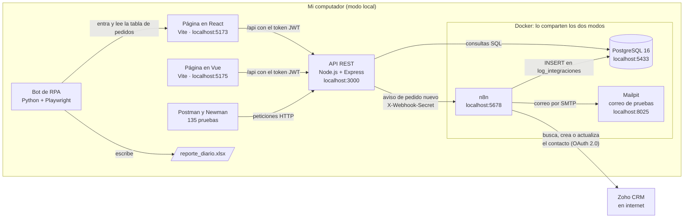
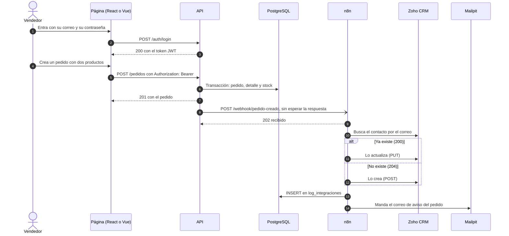
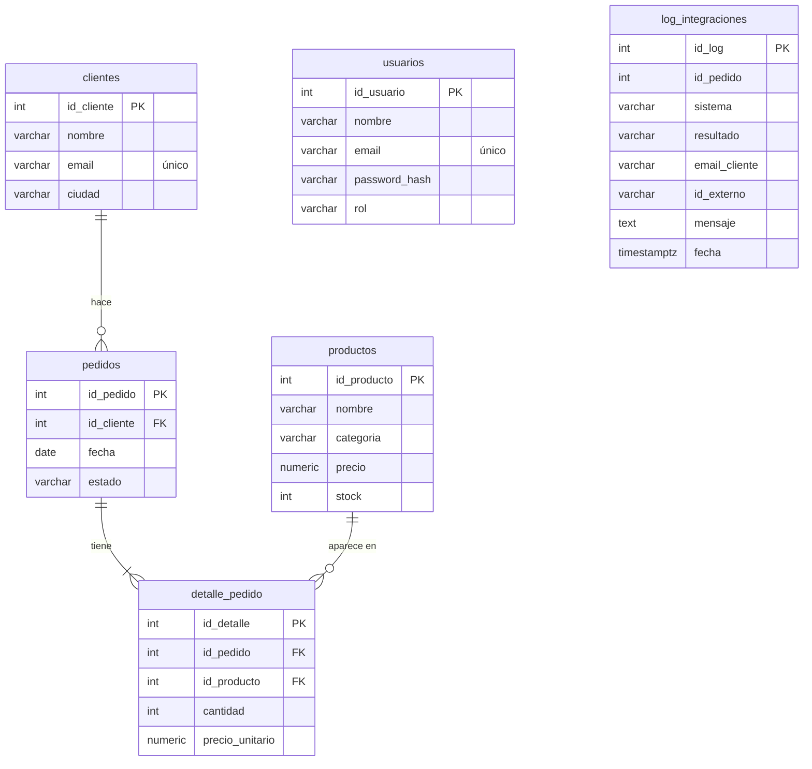

# Arquitectura del proyecto integrador

El proyecto es una tienda: clientes, productos y pedidos. Un vendedor entra a la página, crea un pedido y el resto pasa solo: la API guarda el pedido, n8n pasa el cliente a Zoho CRM, deja un registro en la base y manda un correo. Al final del día, un bot de RPA arma el reporte de los pedidos en Excel.

## El diagrama

Así se ve en el **modo local**, que es la forma principal de correrlo: la API y las páginas corren en el computador, y la base, n8n y Mailpit corren en Docker. Esas tres partes son las mismas en los dos modos, así que todo queda guardado en un solo lugar.



En el **modo Docker**, que es la segunda opción, `docker compose up -d --build` prende también la API y las páginas en contenedores. Usan la misma base, el mismo n8n y el mismo Mailpit (ver [Local y Docker: qué cambia](#local-y-docker-qué-cambia)).

## Qué hace cada parte

| Parte | Qué es | Qué hace | Carpeta |
|---|---|---|---|
| Base de datos | PostgreSQL 16 | Guarda los clientes, los productos, los pedidos con su detalle, los usuarios y el log de las integraciones | `proyecto/api/db` |
| API | Node.js 24, Express 5, `pg`, zod, JWT | Recibe las peticiones, revisa el token y los datos, aplica las reglas del negocio y habla con la base | `proyecto/api` |
| Pruebas | Postman y Newman, `node --test` | 135 pruebas de la colección y 32 pruebas automáticas de la API | `proyecto/postman`, `proyecto/api/test` |
| Página en React | React 19, React Router, Vite | Login, lista de pedidos con filtro y páginas, crear pedidos y cambiarles el estado | `proyecto/frontend-react` |
| Página en Vue | Vue 3, Vue Router, Pinia, Vite | La misma página, hecha en Vue | `proyecto/frontend-vue` |
| Zoho CRM | CRM en la nube, API v8 | Guarda los contactos. Tiene campos, vistas, reglas y una función de Deluge configurados | `proyecto/zoho` |
| n8n | n8n 2.44.5 | El workflow **Pedido a Zoho CRM**: recibe el aviso de cada pedido, pasa el cliente a Zoho, lo registra en la base y avisa por correo | `proyecto/n8n` |
| Mailpit | Servidor de correo de pruebas | Recibe los correos de n8n y los muestra en una página. No los envía a internet | `proyecto/docker-compose.yml` |
| Bot de RPA | Python, Playwright y openpyxl | Entra a la página de React como un vendedor, lee los pedidos del día y arma el Excel | `proyecto/rpa` |

## Qué pasa cuando se crea un pedido



1. El vendedor entra. La API revisa la contraseña con bcrypt y le devuelve un **token JWT**, que dura una hora.
2. La página manda el pedido con ese token. La API valida los datos con **zod**, revisa que el cliente exista y que haya stock.
3. La API guarda el pedido en una **transacción**: el pedido, sus líneas y el descuento del stock entran juntos. Si algo falla, se deshace todo (`ROLLBACK`).
4. La API responde `201` y, **sin esperar**, le avisa a n8n en un webhook. El aviso lleva el secreto en el encabezado `X-Webhook-Secret`. Si n8n no responde, la API lo intenta 3 veces y el pedido queda guardado igual.
5. n8n valida el aviso, contesta `202` y busca el cliente en Zoho por su correo. Si existe lo actualiza y, si no, lo crea.
6. n8n escribe el resultado en la tabla `log_integraciones` (`creado`, `actualizado`, `rechazado` o `error`) y manda un correo que se ve en Mailpit.
7. Cuando se necesita el reporte, el **bot de RPA** entra a la página de React, lee los pedidos del día página por página y escribe `reporte_diario.xlsx`.

## La API por capas

Cada petición pasa por las mismas capas, y cada capa tiene una sola tarea:

```text
petición → rutas → controladores → servicios → repositorios → PostgreSQL
```

| Capa | Qué hace | Ejemplo |
|---|---|---|
| Rutas | Qué método y qué URL va a qué controlador, y quién la puede usar | `rutas/pedidos.rutas.js`: `POST /pedidos` necesita el token |
| Controladores | Validan lo que llega con zod y arman la respuesta | `controladores/pedidos.controlador.js` |
| Servicios | Las reglas del negocio: stock, estados, transacciones | `servicios/pedidos.servicio.js` |
| Repositorios | Las consultas SQL, con parámetros (`$1`, `$2`) | `repositorios/pedidos.repositorio.js` |
| Middlewares | El token JWT, los roles, el log de cada petición y el manejo de errores | `middlewares/` |
| Integraciones | El aviso a n8n | `integraciones/n8n.js` |

Si algo falla en cualquier capa, el error llega al middleware `manejarErrores`, que responde el código HTTP y un mensaje claro: `400` datos malos, `401` sin token, `403` sin permiso, `404` no existe, `409` conflicto (sin stock, correo repetido).

## La base de datos



- El total de un pedido no se guarda: se calcula con `SUM(cantidad * precio_unitario)` del detalle.
- `precio_unitario` guarda el precio del momento de la compra, así el pedido no cambia si después sube el producto.
- `usuarios` son los que entran a la página y a la API. La contraseña se guarda como hash de bcrypt.
- `log_integraciones` no tiene llave foránea a `pedidos`: así también quedan registrados los avisos rechazados, con un pedido que no existe.
- Los scripts están en `proyecto/api/db`: `01_modelo.sql`, `02_datos.sql` y `03_integraciones.sql`.

## Seguridad

- **Login con JWT:** todas las rutas piden el token en `Authorization: Bearer ...`, menos `/salud`, `/auth/login` y consultar los productos. Borrar clientes, productos y pedidos solo lo puede hacer el rol `admin`.
- **Contraseñas con bcrypt:** en la base no está la contraseña, está su hash.
- **Datos validados con zod:** si algo llega mal, la API responde `400` con el error de cada campo y no toca la base.
- **SQL con parámetros:** las consultas usan `$1`, `$2`... y nunca pegan el texto del usuario en el SQL. Así se evita la inyección de SQL.
- **helmet y CORS:** helmet agrega encabezados de seguridad, y CORS deja usar la API solo desde la página configurada en `CORS_ORIGIN`.
- **Webhook con secreto:** n8n solo acepta avisos que traigan el secreto en `X-Webhook-Secret`. Si no viene o está mal, responde `403` y el workflow no corre.
- **OAuth 2.0 con Zoho:** n8n guarda la credencial de Zoho cifrada y renueva solo el access token cuando vence.
- **Secretos fuera de Git:** las contraseñas y las llaves van en los archivos `.env`, que están en el `.gitignore`. En el repo solo van los `.env.example`, vacíos. Los entornos de Postman también van vacíos.

## Manejo de errores

| Dónde | Qué pasa si algo falla |
|---|---|
| API | El middleware `manejarErrores` responde el código y el mensaje. Los errores inesperados responden `500` y el detalle sale en la terminal de la API |
| API → n8n | 3 intentos, esperando 1 y 2 segundos, y máximo 5 segundos por intento. Un `4xx` no se reintenta. El pedido queda guardado aunque n8n esté apagado |
| n8n → Zoho | Buscar y actualizar se reintentan 3 veces. Crear no se reintenta, para no crear el contacto dos veces. Si falla, el error queda en `log_integraciones` y llega un correo |
| n8n en general | Si falla otra cosa, como la base o el correo, corre el Error Workflow **Aviso de errores** y manda un correo con el nodo que falló |
| Bot de RPA | Si no puede entrar o la página no responde, dice qué revisar y guarda una captura en `salida/errores/` |

## Local y Docker: qué cambia

La base, n8n y Mailpit corren siempre en Docker y son los mismos para los dos modos. Lo que cambia es dónde corren la API y las páginas.

| | Modo local (principal) | Modo Docker (segunda opción) |
|---|---|---|
| Cómo se prende | `docker compose up -d postgres mailpit n8n`, y después `npm run dev` en la API y en la página | `docker compose up -d --build` en la carpeta `proyecto` |
| Página en React | <http://localhost:5173> | <http://localhost:8080> |
| Página en Vue | <http://localhost:5175> | <http://localhost:8082> |
| API | <http://localhost:3000> | <http://localhost:3001> |
| La API se conecta a la base en | `localhost:5433` | `postgres:5432` |
| La API avisa a n8n en | `http://localhost:5678/webhook/pedido-creado` | `http://n8n:5678/webhook/pedido-creado` |
| Quién le pasa `/api` a la API | Vite (`vite.config.js`) | nginx (`nginx.conf`) |
| El bot de RPA entra a | `http://localhost:5173` | `http://localhost:8080` |
| Entorno de Postman | `local` | `docker` |
| La base, n8n y Mailpit | Los mismos: `proyecto-postgres`, `proyecto-n8n` y `proyecto-mailpit` | Los mismos |

Dentro de Docker, cada contenedor encuentra a los otros por el nombre del servicio (`postgres`, `n8n`, `mailpit`), porque Docker Compose los pone en la misma red. Por eso las credenciales de n8n usan `postgres:5432` y `mailpit:1025`, y sirven para los dos modos. Desde el computador, en cambio, se entra por los puertos publicados: la base en `localhost:5433`, n8n en `localhost:5678` y Mailpit en `localhost:8025`.

Como la base es una sola, un pedido creado en un modo se ve en el otro, y `npm run db:init` deja los datos de ejemplo para los dos. Los datos quedan en los volúmenes `datos-postgres` y `datos-n8n`: no se borran al apagar los contenedores, solo con `docker compose down -v`.
