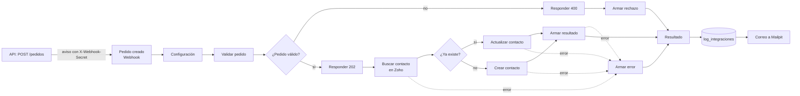

# Pedido a Zoho CRM con n8n (proyecto integrador, parte 7)

Cada vez que se crea un pedido, la API le avisa a n8n. El workflow **Pedido a Zoho CRM**:

1. Recibe el aviso en un webhook, que solo acepta avisos con el secreto de la API.
2. Valida los datos del pedido y del cliente.
3. Busca el cliente en Zoho CRM por el correo.
4. Si el contacto no existe lo crea, y si existe lo actualiza.
5. Registra el resultado en la tabla `log_integraciones` de PostgreSQL.
6. Manda un correo de notificación, que se ve en Mailpit.

Si algo falla, también queda registrado y avisa por correo.

| Archivo o carpeta | Qué es |
|---|---|
| `pedido-a-zoho.json` | El workflow, para importarlo en n8n. No tiene credenciales ni secretos |
| `archivos/` | La carpeta compartida con n8n (`/home/node/.n8n-files` en el contenedor). La usa el ejercicio básico del día 14 |

## Cómo funciona



| Nodo | Qué hace |
|---|---|
| **Pedido creado** (Webhook) | Recibe `POST /webhook/pedido-creado`. Con la credencial **Secreto de la API** revisa que el encabezado `X-Webhook-Secret` traiga el secreto; si no, responde 403 sin correr el flujo |
| **Configuración** (Edit Fields) | Los valores que se pueden cambiar: la dirección de la API de Zoho (`zohoApi`), a quién le llegan los correos (`correoAvisos`) y quién los manda (`correoRemitente`) |
| **Validar pedido** (Code) | Revisa que llegue el evento `pedido.creado`, el id del pedido, el nombre y un correo válido del cliente, productos y un total mayor que 0. También separa el nombre y el apellido para Zoho y arma el texto del campo Descripción |
| **¿Pedido válido?** (If) | Si falló la validación, va por la salida `false` |
| **Responder rechazado** / **Responder recibido** (Respond to Webhook) | Le contestan a la API: 400 con los errores, o 202 apenas se recibe el pedido. Así la API no espera a que termine Zoho |
| **Buscar contacto en Zoho** (HTTP Request) | `GET /crm/v8/Contacts/search?email=...` con la credencial **Zoho CRM**. Zoho responde 200 si lo encontró y 204 si no |
| **¿Ya existe en Zoho?** (If) | Revisa si la búsqueda respondió 200 |
| **Actualizar contacto** (HTTP Request) | `PUT /crm/v8/Contacts/{id}` con la ciudad y la descripción del último pedido |
| **Crear contacto** (HTTP Request) | `POST /crm/v8/Contacts` con el nombre, el apellido, el correo, la ciudad y la descripción |
| **Armar resultado** / **Armar rechazo** / **Armar error** (Code) | Arman la fila para el log y el asunto y el texto del correo de cada caso |
| **Resultado** (No Operation) | Junta los tres casos en un solo camino |
| **Registrar en log_integraciones** (Postgres) | `INSERT` con parámetros (`$1`, `$2`...), que evitan la inyección de SQL |
| **Notificar por correo** (Send Email) | Manda el correo con la credencial **SMTP de Mailpit** |

En la tabla `log_integraciones`, la columna `resultado` puede ser `creado`, `actualizado`, `rechazado` o `error`. También quedan el id del pedido, el correo del cliente, el id del contacto en Zoho, un mensaje y la fecha.

## Prepararlo (una sola vez)

### 1. n8n prendido

Sigue **Antes de empezar: n8n en Docker** en [`../../semana-3/rpa-n8n/README.md`](../../semana-3/rpa-n8n/README.md): los dos valores nuevos del `.env`, `docker compose up -d --build` y tu cuenta de n8n.

### 2. La tabla `log_integraciones`

Si la base de Docker se creó antes de esta parte, la tabla no existe todavía: los scripts de `api/db` solo corren solos cuando el volumen está vacío. Créala una vez, parado en `proyecto`:

```powershell
docker compose exec postgres psql -U postgres -d proyecto -f /docker-entrypoint-initdb.d/03_integraciones.sql
```

Debe responder `CREATE TABLE` y `CREATE INDEX`. El script se puede correr varias veces sin borrar nada. Con `npm run db:init` la tabla también se crea en la base local.

### 3. Un cliente de Zoho para n8n

El Self Client del día 13 sirve para Postman, pero n8n necesita otro tipo de cliente para conectarse solo y renovar el token cuando vence.

1. Entra a <https://api-console.zoho.com> y dale **Add Client** → **Server-based Applications** → **Create Now**.
2. Llena el formulario:
   - Client Name: `n8n inducción`
   - Homepage URL: `http://localhost:5678`
   - Authorized Redirect URIs: `http://localhost:5678/rest/oauth2-credential/callback`
3. Dale **Create**. En la pestaña **Client Secret** quedan el **Client ID** y el **Client Secret**. No los pegues en ningún archivo del repo.

### 4. Las credenciales en n8n

En n8n: **Overview** → pestaña **Credentials** → **Create credential**. Busca el tipo, dale **Continue**, llena los campos y dale **Save**. Para cambiar el nombre de la credencial, haz clic en el título de arriba (por ejemplo **Zoho account**).

| Nombre | Tipo | Campos |
|---|---|---|
| `Zoho CRM` | **Zoho OAuth2 API** | **Access Token URL**: `US - https://accounts.zoho.com/oauth/v2/token` (si tu cuenta no es `.com`, escoge la de tu data center). **Client ID** y **Client Secret**: los del paso 3. Después dale **Connect**, entra con tu cuenta de Zoho y acepta los permisos. Debe quedar conectada |
| `Secreto de la API` | **Header Auth** | **Name**: `X-Webhook-Secret`. **Value**: el mismo texto de `N8N_WEBHOOK_SECRET` en `proyecto/.env` |
| `PostgreSQL del proyecto` | **Postgres** | **Host**: `postgres`. **Database**: `proyecto`. **User**: `postgres`. **Password**: la de `POSTGRES_PASSWORD` en `proyecto/.env`. **Port**: `5432` |
| `SMTP de Mailpit` | **SMTP** | Es la del ejercicio avanzado del día 14: **User** `n8n`, **Password** `n8n`, **Host** `mailpit`, **Port** `1025` y **SSL/TLS** apagado |

Para PostgreSQL se usa `postgres` y el puerto 5432 porque n8n está dentro de la red de Docker. Desde tu computador, en cambio, la base está en `localhost:5433`.

### 5. Importar el workflow

1. **Create workflow** → menú **...** al lado del nombre → **Import** → **From file** → `proyecto/n8n/pedido-a-zoho.json`.
2. Sale el aviso **Credentials auto-added**: n8n les puso a los nodos las credenciales que creaste.
3. Abre los nodos **Buscar contacto en Zoho**, **Actualizar contacto** y **Crear contacto**, y revisa que en **Zoho OAuth2 API** esté escogida `Zoho CRM`. Si un nodo tiene un triángulo rojo, ábrelo y escógela.
4. Abre **Configuración** y revisa `zohoApi`: `https://www.zohoapis.com` para una cuenta `.com`. Si tu cuenta es de otro data center, cámbialo, por ejemplo a `https://www.zohoapis.eu`.
5. Menú **...** → **Settings** → **Error Workflow (to notify when this one errors)** → **Aviso de errores** (el Error Workflow del ejercicio avanzado, que ya debe estar publicado) → **Save**.
6. Dale **Publish** y otra vez **Publish**. Desde ese momento la URL `http://localhost:5678/webhook/pedido-creado` queda escuchando.

## Probarlo

1. **Crea un pedido.** Abre <http://localhost:8080>, entra con `vendedor@cielum.test` / `Vendedor2026*` y crea un pedido en **Nuevo pedido**.
2. **Revisa la ejecución.** En n8n, en el workflow, pestaña **Executions**: sale una ejecución nueva. Al abrirla se ve qué pasó en cada nodo.
3. **Revisa Zoho CRM.** En **Contactos** sale el cliente del pedido, y en **Descripción** dice `Último pedido: #... del ... por $ ...`.
4. **Revisa el correo.** En Mailpit (<http://localhost:8025>) llega *Pedido #...: el contacto se creó en Zoho CRM*.
5. **Revisa el log.** En Adminer (<http://localhost:8081>), tabla `log_integraciones`, o con este comando, parado en `proyecto`:

   ```powershell
   docker compose exec postgres psql -U postgres -d proyecto -c "SELECT id_log, id_pedido, resultado, email_cliente, id_externo, fecha FROM log_integraciones ORDER BY id_log DESC LIMIT 5;"
   ```

6. **Crea otro pedido del mismo cliente.** Esta vez el resultado es `actualizado`, y el correo dice *el contacto se actualizó*.
7. **Prueba el rechazo con Postman.** Haz una petición nueva `POST http://localhost:5678/webhook/pedido-creado`:
   - En **Headers**, agrega `X-Webhook-Secret` con tu secreto.
   - En **Body** → **raw** → **JSON**, pega:

     ```json
     {
       "evento": "pedido.creado",
       "pedido": { "id_pedido": 999, "fecha": "2026-10-21", "total": 0, "detalle": [] },
       "cliente": { "nombre": "Cliente de prueba", "email": "no-es-correo", "ciudad": "Cali" }
     }
     ```

   Responde `400` con la lista de errores, y en el log queda una fila `rechazado`.
8. **Prueba sin secreto.** Quita el encabezado y envía otra vez: responde `403` con `Authorization data is wrong!` y el flujo no corre.

## Manejo de errores

- **Salida de error:** los nodos de Zoho y **Armar resultado** tienen **Settings** → **On Error** → **Continue (using error output)**. Si fallan, el item sigue por la salida de error hacia **Armar error**. Ese nodo arma un mensaje con el código HTTP y el código de Zoho (por ejemplo `HTTP 401 · INVALID_TOKEN · invalid oauth token`), lo registra como `error` en el log y avisa por correo.
- **Reintentos:** **Buscar contacto** y **Actualizar contacto** tienen **Retry On Fail**: 3 intentos, con 2 segundos entre uno y otro. **Crear contacto** no se reintenta, porque un `POST` repetido podría crear el contacto dos veces.
- **Error Workflow:** si falla otra cosa, como la base de datos o el correo, corre **Aviso de errores** y manda un correo con el nodo que falló.
- **Del lado de la API:** si n8n está apagado o responde 500, la API reintenta 3 veces (esperando 1 y 2 segundos) sin frenar la respuesta del pedido. El pedido se guarda igual, y el error queda en el log de la API (`docker compose logs api`).

## Idempotencia

Si el mismo pedido llega dos veces, por ejemplo por un reintento, no se crea un contacto repetido. La segunda vez la búsqueda por correo encuentra el contacto y lo actualiza con los mismos datos. Solo queda una fila más en el log y llega un correo más.

## Si algo falla

| Lo que pasa | Por qué | Qué hacer |
|---|---|---|
| En `docker compose logs api` sale `n8n rechazó el pedido ... con el código 404` | El workflow no está publicado | Dale **Publish** al workflow |
| ... con el código 403 | El valor de la credencial **Secreto de la API** no es igual a `N8N_WEBHOOK_SECRET` | Corrige la credencial. Si cambiaste el `.env`, corre `docker compose up -d` para que la API tome el valor nuevo |
| `Intento 1 de 3: no se pudo avisar a n8n ... (fetch failed)` | n8n está apagado | `docker compose up -d n8n` |
| **Buscar contacto en Zoho** falla con `Credentials ... are not set` | El nodo no tiene la credencial | Abre el nodo y escoge `Zoho CRM` |
| El log dice `HTTP 401 · INVALID_TOKEN` | La credencial de Zoho no está conectada o es de otro data center | En la credencial dale **Connect** otra vez y revisa **Access Token URL** y `zohoApi` |
| **Registrar en log_integraciones** falla con `relation "log_integraciones" does not exist` | Falta crear la tabla | Corre el paso 2 de **Prepararlo** |
| No llega el correo | La credencial SMTP está mal | Revisa que el host sea `mailpit`, el puerto `1025` y que **SSL/TLS** esté apagado |
| El webhook responde `{"message":"Workflow was started"}` en lugar de 202 | Se cambió el nodo **Pedido creado** | En **Respond** debe decir **Using 'Respond to Webhook' Node** |
