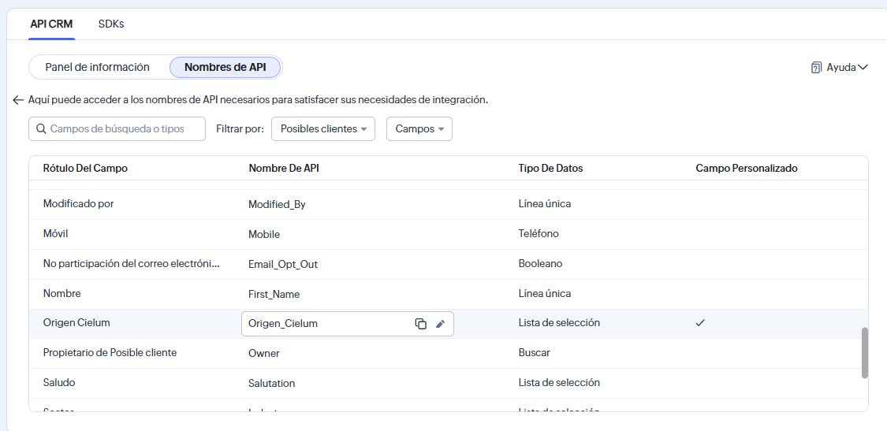
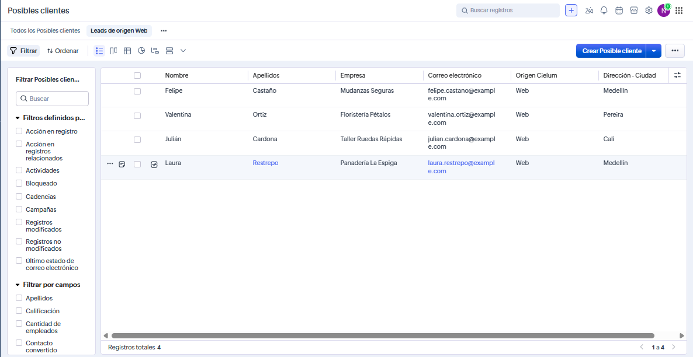
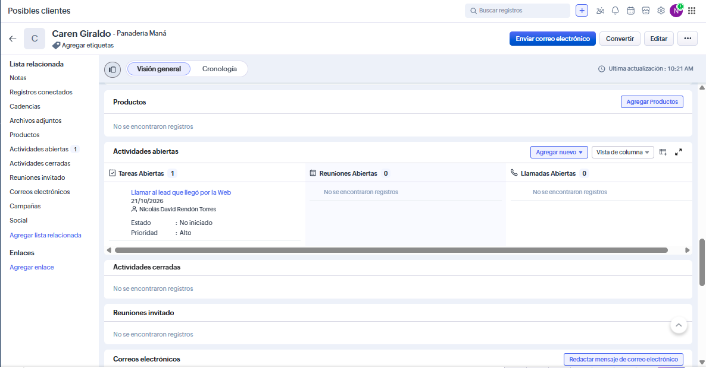

# Configuración de Zoho CRM

Lo que se configuró en Zoho CRM para el proyecto integrador (parte 6), con sus capturas de pantalla.

## La cuenta

| Dato | Valor |
|---|---|
| Edición | Prueba gratis |
| Data center | Estados Unidos (`.com`): `crm.zoho.com`, `accounts.zoho.com` y `www.zohoapis.com` |
| Módulos que se usan | Leads, Contacts, Accounts, Deals y Tasks |
| Versión de la API | v8 |

Si tu cuenta quedó en otro data center, cambia esta tabla y el `accounts_url` del entorno de Postman.

## 1. Campo personalizado "Origen Cielum"

| Propiedad | Valor |
|---|---|
| Módulo | Leads |
| Etiqueta | Origen Cielum |
| Nombre de API | `Origen_Cielum` |
| Tipo | Lista de selección (*Pick List*) |
| Opciones | Web, Referido, Evento |
| Diseño | Estándar, en la sección de información del lead |

## 2. Vista "Leads de origen Web"

| Propiedad | Valor |
|---|---|
| Módulo | Leads |
| Criterio | Origen Cielum es Web |
| Columnas | Nombre, Empresa, Correo electrónico, Ciudad, Origen Cielum |
| Resultado con los datos del CSV | 4 leads: Laura Restrepo, Julián Cardona, Valentina Ortiz y Felipe Castaño |

## 3. Regla "Tarea para leads de la Web"

| Propiedad | Valor |
|---|---|
| Módulo | Leads |
| Cuándo | Al crear un registro |
| Condición | Origen Cielum es Web |
| Acción instantánea | Tarea: "Llamar al lead que llegó por la Web", vence 1 día después de la regla, prioridad alta, asignada al propietario del lead |

## 4. Campo "Ultimo trato" en Contacts

| Propiedad | Valor |
|---|---|
| Módulo | Contacts |
| Etiqueta | Ultimo trato |
| Nombre de API | `Ultimo_trato` |
| Tipo | Línea única (*Single Line*) |
| Lo llena | La función de Deluge `actualizar_contacto_del_trato` |

## 5. Regla "Actualizar contacto al crear trato" y su función de Deluge

| Propiedad | Valor |
|---|---|
| Módulo | Deals |
| Cuándo | Al crear un registro |
| Condición | Todos los tratos |
| Acción instantánea | Función `actualizar_contacto_del_trato`, con el argumento `dealId` = Deal Id |
| Código | [`deluge/actualizar_contacto_del_trato.dg`](deluge/actualizar_contacto_del_trato.dg) |

## 6. Self Client para la API

| Propiedad | Valor |
|---|---|
| Consola | <https://api-console.zoho.com> |
| Tipo de cliente | Self Client |
| Scopes | `ZohoCRM.modules.ALL,ZohoCRM.coql.READ` |
| Duración del grant token | 10 minutos |

## 7. La colección de Postman

La colección **zoho-crm** (`postman/`) con el entorno **zoho-crm**. Qué tiene y cómo se corre está en [`README.md`](README.md#la-colección-zoho-crm).

## Las capturas

Están en `capturas/`:

| Archivo | Qué muestra |
|---|---|
| `01-campo-origen-cielum.png` | El campo `Origen_Cielum` en los nombres de API de Leads, como lista de selección y campo personalizado |
| `02-vista-leads-web.png` | La vista **Leads de origen Web** con los 4 leads |
| `03-tarea-creada.png` | Un lead de origen Web con la tarea *Llamar al lead que llegó por la Web* en **Actividades abiertas** |

Si se agregan más, deben seguir la misma numeración y no mostrar secretos: ni el Client Secret, ni el grant token, ni el access token, ni el refresh token.
