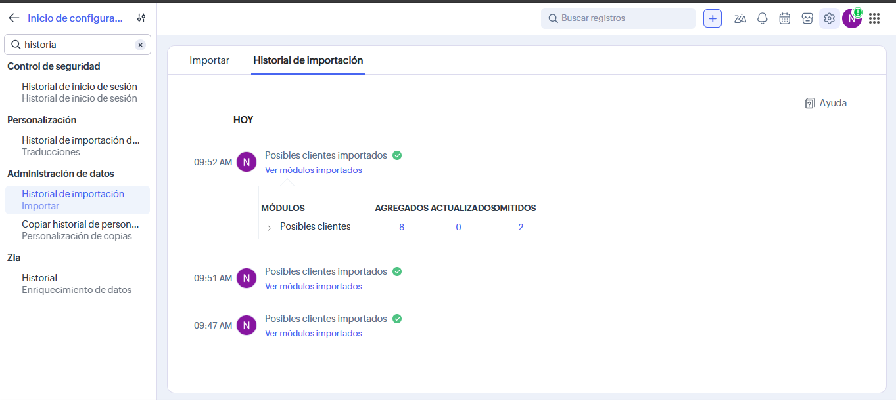
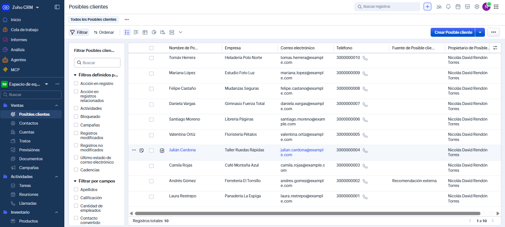

# Ejercicios del día 13: Zoho CRM

Casi todo este día se hace dentro de Zoho CRM, en el navegador. Esta carpeta tiene los archivos de apoyo y la guía de cada paso.

| Archivo | Para qué sirve |
|---|---|
| `leads-ficticios.csv` | 10 leads inventados para el ejercicio básico. Los correos son `@example.com` y los teléfonos no existen |
| `postman/zoho-leads.postman_collection.json` | Ejercicio avanzado: tokens, CRUD y búsquedas de Leads con la API v8 |
| `postman/zoho.postman_environment.json` | El entorno de Postman con las variables vacías, sin tokens reales |
| `capturas/` | Las capturas del ejercicio básico: la importación y la lista de leads |

## Antes de empezar: la cuenta de prueba

1. Entra a <https://www.zoho.com/crm/> y crea una cuenta con la **prueba gratis**. Así tienes las reglas de flujo de trabajo y las funciones de Deluge, que no vienen en todas las ediciones.
2. Revisa el **data center** de tu cuenta en la dirección del navegador:
   - Si dice `crm.zoho.com`, es el de Estados Unidos (`.com`). Ese es el que traen por defecto el entorno de Postman y esta guía.
   - Si dice otro dominio, como `crm.zoho.eu` o `crm.zoho.in`, usa ese dominio en la consola de la API y en el entorno de Postman (`accounts_url`).

Los nombres de los menús salen en español o en inglés, según el idioma de la cuenta. En esta guía van los dos cuando cambian mucho. Por ejemplo, Leads sale como **Posibles clientes** y Deals como **Tratos**.

## Básico: 10 leads, a mano y con un CSV

**1. Crea 2 leads a mano.** Usa las dos primeras filas del CSV: Laura Restrepo y Andrés Gómez.
1. Ve a **Leads** → **Crear lead** (botón **+**).
2. Llena Nombre, Apellidos, Empresa, Correo electrónico, Teléfono y Ciudad.
3. Dale **Guardar**.

**2. Importa el CSV con los 10.**
1. En **Leads**, abre el menú de la lista (**...**) → **Importar** → **Desde archivo** y sube `leads-ficticios.csv`.
2. Si las tildes se ven raras, escoge la codificación **UTF-8**. Dale **Siguiente**.
3. Revisa el mapeo: cada columna con su campo (First Name → Nombre, Last Name → Apellidos, Company → Empresa, Email → Correo electrónico, Phone → Teléfono, City → Ciudad). La columna **Origen Cielum** queda **sin mapear**, porque el campo todavía no existe.
4. En los registros duplicados, escoge buscarlos por **Correo electrónico** y **Omitirlos**.
5. Dale **Importar**.

**3. Revisa el resultado.** Zoho debe decir que agregó 8 y omitió 2: los dos que ya creaste a mano. En la lista de Leads deben quedar 10.

## Intermedio: campo, vista y workflow

**1. Crea el campo "Origen Cielum".**
1. ⚙ **Configuración** → **Personalización** → **Módulos y campos** → **Leads** → **Diseños** → **Estándar**.
2. Arrastra una **Lista de selección** (*Pick List*) a la sección de información del lead.
3. Ponle de etiqueta `Origen Cielum` y deja solo tres opciones: `Web`, `Referido` y `Evento`.
4. Dale **Listo** y **Guardar y cerrar**.

Revisa su nombre de API en ⚙ **Configuración** → **Developer Hub** → **API y SDK** → **Nombres de API** → **Leads**. Debe ser `Origen_Cielum`, que es el que usan las colecciones de Postman. Si es otro, cámbialo en las peticiones.

**2. Llena el campo en los 10 leads.** Importa otra vez el CSV, pero esta vez:
- Mapea la columna **Origen Cielum** al campo nuevo.
- En los duplicados por **Correo electrónico**, escoge **Actualizar** (o **Sobrescribir**) en lugar de omitir.

**3. Crea la vista.**
1. En **Leads**, abre la lista de vistas (arriba a la izquierda) → **Crear vista**.
2. Nombre: `Leads de origen Web`.
3. Criterio: **Origen Cielum** es **Web**.
4. Columnas: Nombre, Empresa, Correo electrónico, Ciudad y Origen Cielum.
5. Dale **Guardar**.

Deben salir 4 leads: Laura Restrepo, Julián Cardona, Valentina Ortiz y Felipe Castaño.

**4. Crea la regla de flujo de trabajo.**
1. ⚙ **Configuración** → **Automatización** → **Reglas de flujo de trabajo** → **Crear regla**.
2. Módulo **Leads**, nombre `Tarea para leads de la Web`.
3. Cuándo: **Al realizar una acción en un registro** → **Crear**.
4. Condición: **Origen Cielum** es **Web**.
5. En **Acciones instantáneas**, escoge **Tarea** y llena:
   - Asunto: `Llamar al lead que llegó por la Web`.
   - Fecha de vencimiento: la fecha de activación de la regla más 1 día.
   - Prioridad: Alta.
   - Asignar a: el propietario del registro.
6. Guarda la tarea y la regla.

**5. Pruébala.** Crea un lead nuevo con **Origen Cielum** = Web y ábrelo: en **Actividades abiertas** debe estar la tarea. Si creas uno con Evento, no se crea ninguna tarea.

La regla solo corre para los leads que se crean después de guardarla. Los 10 del CSV no tienen tarea.

## Avanzado: la API con Postman

**1. Crea el Self Client.**
1. Entra a <https://api-console.zoho.com>. Si tu cuenta no es `.com`, usa la consola de tu data center, por ejemplo `https://api-console.zoho.eu`.
2. Dale **Add Client** → **Self Client** → **Create** → **OK**.
3. En la pestaña **Client Secret**, copia el **Client ID** y el **Client Secret**.

**2. Genera el grant token.**
1. Ve a la pestaña **Generate Code**.
2. Llena:
   - Scope: `ZohoCRM.modules.ALL,ZohoCRM.coql.READ`.
   - Time Duration: 10 minutes.
   - Scope Description: `Postman inducción`.
3. Dale **Create**, escoge tu organización y copia el código.

Ese código es el grant token: es de un solo uso y vence en los minutos que escogiste. Si se vence, genera otro.

**3. Prepara Postman.**
1. **Import** → arrastra los dos archivos de la carpeta `postman/`.
2. Arriba a la derecha, escoge el entorno **zoho**.
3. En el entorno, llena la columna **Current value** (no **Initial value**) de `client_id`, `client_secret` y `grant_token`.
4. Si tu cuenta no es `.com`, cambia también `accounts_url`.

**4. Cambia el grant token por los tokens.** Corre **0. Tokens** → **Cambiar el grant token por tokens**. La prueba guarda en el entorno:
- el `access_token`;
- el `refresh_token`;
- el `api_domain`, que dice a qué dominio de la API se llama según el data center de la cuenta;
- `token_vence`, que dice a qué hora vence el access token.

También borra el grant token, porque ya se usó.

**5. Corre la carpeta 1. Leads.** Dale clic derecho → **Run folder**. Corre, en orden, crear, consultar, listar, actualizar, buscar por correo, buscar con COQL y borrar el lead de prueba. Así la cuenta queda como estaba.

**6. Prueba la renovación automática.** Antes de cada petición, la colección revisa si el access token ya venció o le falta menos de 1 minuto. Si es así, pide uno nuevo con el refresh token y lo guarda en el entorno. Para verlo:
1. En el entorno, pon `token_vence` en `0`.
2. Envía **Crear lead**.
3. En la consola de Postman (**View** → **Show Postman Console**) sale `Access token renovado con el refresh token`.

**Ten en cuenta:**
- Los valores secretos van solo en **Current value**, que se queda en tu computador. El entorno de este repo va vacío: no lo exportes con valores ni lo subas con tus tokens.
- **Buscar el lead por correo** puede responder 204 (no encontró nada) justo después de crearlo, porque la búsqueda tarda unos segundos en ver los registros nuevos. Si pasa, envíala otra vez.
- Si Zoho responde `INVALID_TOKEN` o `invalid_code`, el token o el código ya no sirven: genera otro código y vuelve al paso 4.

## Lo que pide cada ejercicio y dónde queda

| Ejercicio | Qué se hace | Dónde se ve |
|---|---|---|
| Básico | Cuenta de prueba, 2 leads a mano y 8 con el CSV | En Zoho, en la lista de Leads, y en `capturas/` |
| Intermedio | Campo Origen Cielum, vista Leads de origen Web y regla que crea una tarea | En Zoho. Las capturas van en `proyecto/zoho/configuracion.md` |
| Avanzado | Self Client, tokens y Postman con crear, consultar, actualizar y buscar leads, con renovación automática | `postman/` |
